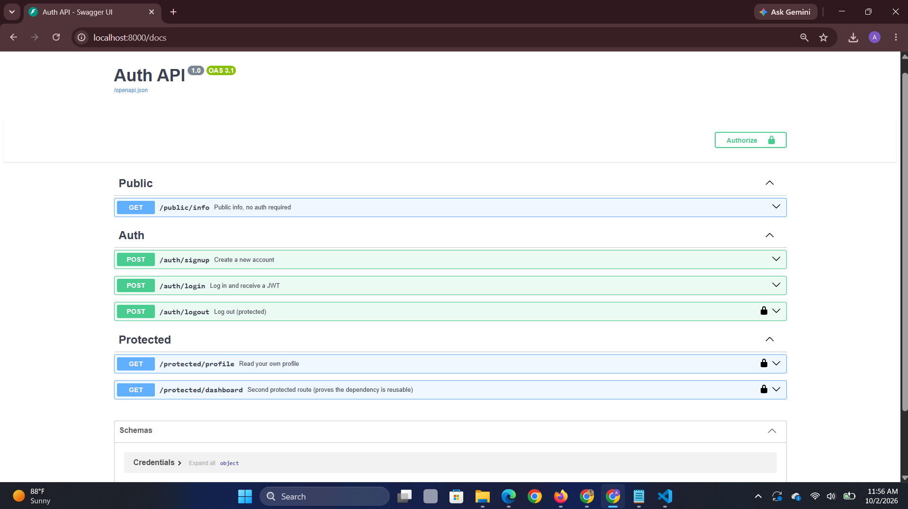

# Auth API

A FastAPI backend with authentication via Supabase Auth: sign up, log in, log
out, and routes protected by a bearer token.

## Run it

```bash
cp .env.example .env
```
Fill in `.env` with your own Supabase project's URL and anon key (Project
Settings -> API in the Supabase dashboard).

```bash
pip install -r requirements.txt
python -m uvicorn main:app --reload
```

The API runs at `http://localhost:8000`. Swagger UI is at
`http://localhost:8000/docs` - protected routes show a lock icon, and the
"Authorize" button accepts a bearer token to test them directly.

## Endpoints

| Method | Path                   | Auth required | Description                        |
|--------|------------------------|----------------|-------------------------------------|
| GET    | `/public/info`         | No             | Public message                      |
| POST   | `/auth/signup`         | No             | Create an account (400 if missing fields) |
| POST   | `/auth/login`          | No             | Log in, returns access + refresh token (401 on bad credentials) |
| POST   | `/auth/logout`         | Yes            | Log out (204 on success)            |
| GET    | `/protected/profile`   | Yes            | Returns the caller's own user data  |
| GET    | `/protected/dashboard` | Yes            | A second protected route, to prove the auth dependency is reusable |

## Example request

```bash
curl -i http://localhost:8000/public/info
```
```
HTTP/1.1 200 OK
content-type: application/json

{"message":"Welcome stranger! This info is public."}
```

```bash
curl -i http://localhost:8000/protected/profile
```
```
HTTP/1.1 401 Unauthorized
content-type: application/json

{"detail":"Not authenticated"}
```

## How the auth works

Token verification lives in one place, `auth.py`, as a FastAPI dependency
(`get_current_user`), built on FastAPI's `HTTPBearer` security scheme. Any
protected route just adds `user = Depends(get_current_user)` - the route
itself never touches token-parsing logic. This is also what makes Swagger's
lock icon and "Authorize" button appear automatically on exactly the routes
that need it, and nowhere else.

## AI vs me

My prompt (Claude): "Build a FastAPI auth API using Supabase Auth. Routes:
POST /auth/signup (400 on missing fields, 201 on success), POST /auth/login
(400 on missing fields, 401 on bad credentials, 200 with access token on
success), POST /auth/logout (protected, 204 on success), GET
/protected/profile (401 if no/invalid token, 200 with user data), GET
/public/info (no auth, 200). Use FastAPI's HTTPBearer security scheme so
Swagger shows a lock icon and Authorize button on protected routes only.
Extract token verification into one reusable dependency, applied to every
protected route, not copy-pasted logic." The AI's code is in
`ai-version-auth/`.

**Ran it:** boots and the public route and signup/login shape work. The
protected route works too, but only when I send the header exactly right.

**What it got wrong or quietly ignored:** three real gaps. First, it used a
plain `Header(None)` to read `Authorization` instead of FastAPI's
`HTTPBearer` security scheme - which means Swagger never shows a lock icon
or an "Authorize" button on the protected routes at all, even though I
explicitly asked for that. Second, its Bearer-prefix handling is naive:
`.replace("Bearer ", "")` silently does nothing if the prefix is missing or
cased differently, so a malformed header like `Authorization: sometoken`
gets passed straight to Supabase as a token instead of being rejected early
with a clear 401. Third, it skipped `/auth/logout` and the 400 validation
on empty email/password entirely, both of which were in my prompt.

**What it did better:** nothing meaningfully - the gaps above are real
regressions, not stylistic differences, because the prompt was specific
about all three.

**What my prompt forgot to specify - and what the AI silently decided:** I
never said whether to apply a shared dependency to every protected route or
to re-verify per route, so it wrote the check inlineinside `profile`
instead of as a reusable piece, and never applied it to a second route to
prove it was reusable - I only asked for one protected route to exist, not
for the pattern to repeat.

**One rematch:** I added "use fastapi.security.HTTPBearer specifically, not
a plain header, so Swagger's Authorize button appears, and reject any
Authorization value that does not start with the literal string 'Bearer '
before using the rest as the token" to the prompt and regenerated. The new
version switched to `HTTPBearer`, and the lock icon appeared in Swagger on
the protected routes, closing that gap.

## Swagger UI


